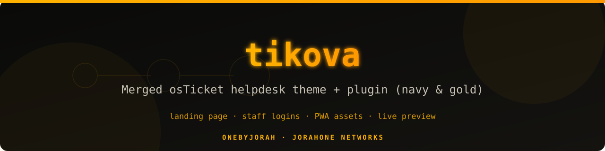
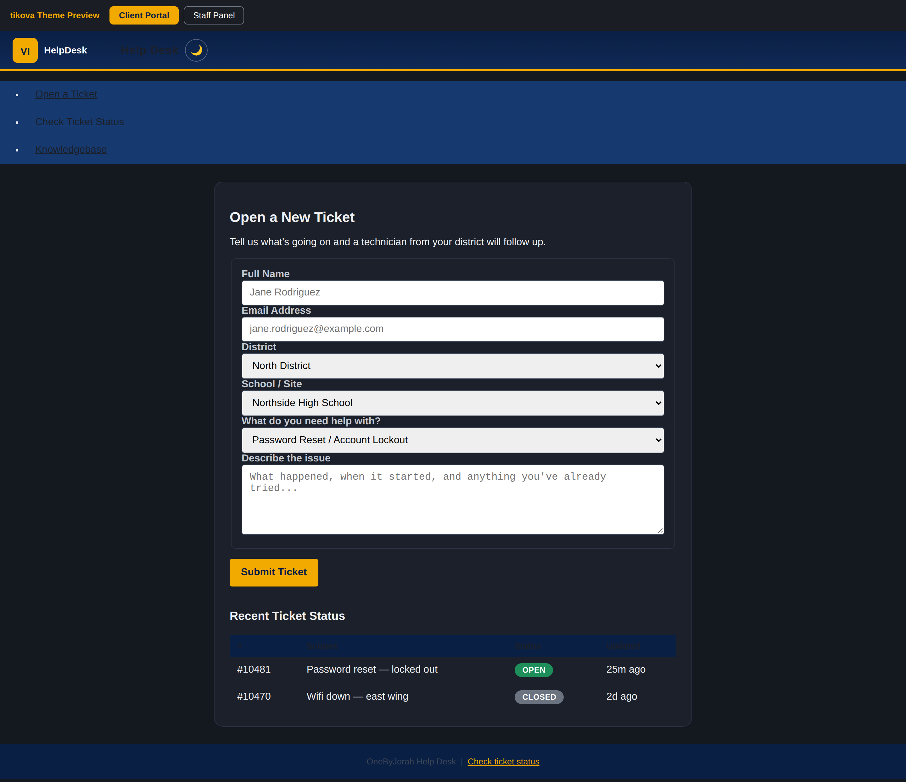
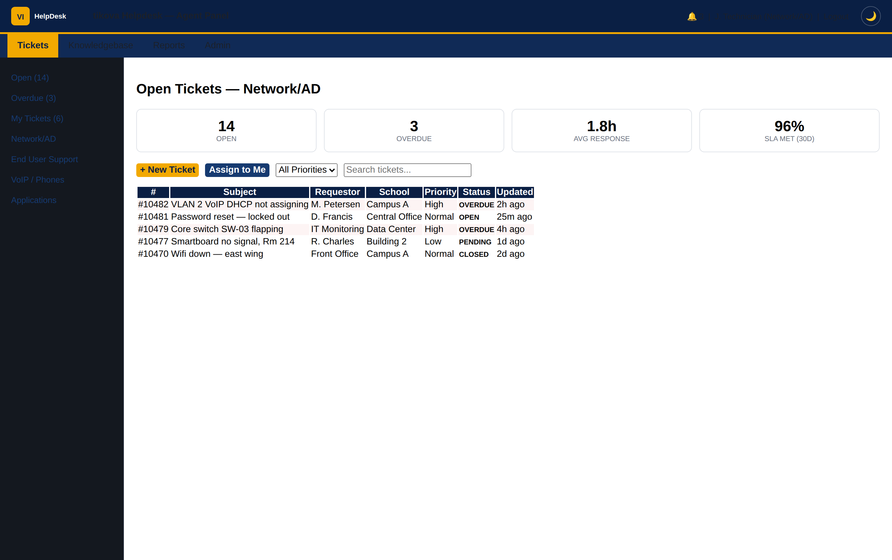
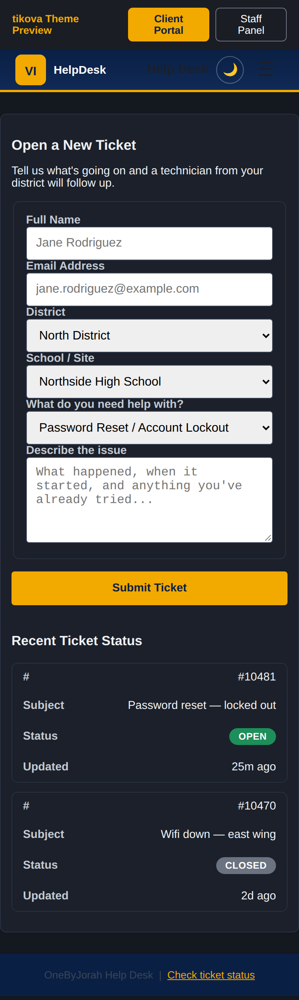
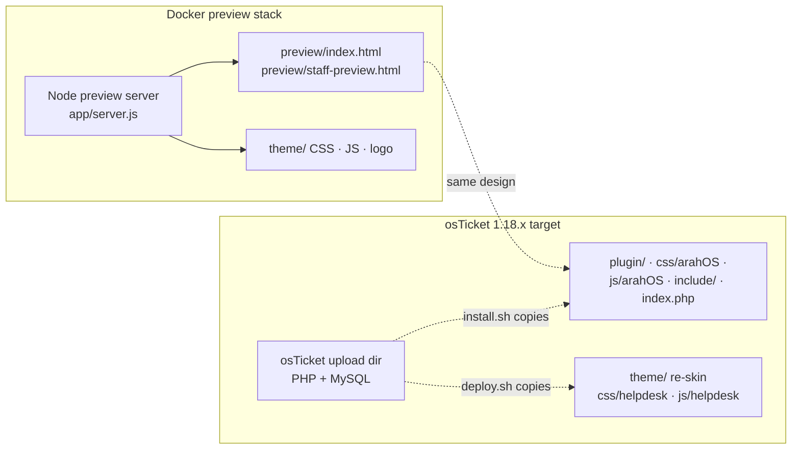

<div align="center">



# tikova

Merged osTicket helpdesk theme + plugin — landing page, staff login panel, client portal, and PWA assets, with a one-command Docker preview stack.

Formerly TicketForge.

[](https://github.com/OneByJorah/tikova/actions/workflows/ci.yml)
[](https://github.com/OneByJorah/tikova/releases)
[](https://github.com/OneByJorah/tikova/pkgs/container/tikova)
[](LICENSE)

</div>



## Why this exists

Stock osTicket looks generic and dated on both the public portal and the staff panel. tikova is a drop-in re-skin: a navy-and-gold client portal, an agent login panel, a rewritten landing page, and PWA assets (manifest, service worker, offline page). It ships as plain files you copy into an osTicket 1.18.x upload directory — no build step, no database changes, easy to back out (every installer keeps backups).

A small Node preview server serves the theme's mockups via Docker so you can evaluate or screenshot the design without standing up PHP, MySQL, or osTicket.

## Features

- **Client portal theme** — hero search, ticket form, status widget, responsive layout (`css/arahOS/arahOS-client-portal.css`).
- **Staff panel theme** — navy/gold agent login with system-status sidebar (`css/arahOS/arahOS-agent-login.css`, `include/staff/`).
- **Rewritten landing page** — `index.php` replaces the osTicket front page with a search-first layout and FAQ accordion.
- **osTicket plugin** — `plugin/` registers the theme and injects the stylesheet through osTicket's plugin system.
- **PWA support** — `manifest.webmanifest`, `sw.js` (cache-first statics, network-first HTML), `offline.html`, `.htaccess` headers.
- **Two installers** — `install.sh` for the full theme (plugin + templates + landing page); `deploy.sh` bootstraps official osTicket v1.18.2 and injects the lighter `theme/` re-skin.
- **Docker preview** — `docker compose up -d --build` serves the static mockups with demo data, no osTicket required.
- **Knowledge base seed** — optional demo FAQs in `db/kb-seed.sql`.





## Quick start (preview stack)

The Docker stack runs a static preview of the theme with demo data. It does **not** include osTicket itself.

```bash
git clone https://github.com/OneByJorah/tikova.git
cd tikova
docker compose up -d --build
```

Open <http://127.0.0.1:8080> for the client-portal preview and <http://127.0.0.1:8080/staff-preview.html> for the staff panel. Health check: `curl http://127.0.0.1:8080/healthz` returns `ok`.

Stop it with `docker compose down -v`.

### Deploying onto a real osTicket

**Linux (bash):**

```bash
# Full theme: plugin + templates + landing page + PWA
sudo ./install.sh /path/to/osticket/upload

# Or: lightweight re-skin — clones official osTicket v1.18.2 and patches the headers
./deploy.sh /path/to/webroot
```

Both scripts back up any file they replace (`.bak` / `.bak-<timestamp>`).

**Windows:** there is no Windows installer. `install.ps1` only prints a note; run the bash installers from WSL or Git Bash against a Linux PHP/MySQL host. osTicket itself is PHP/MySQL software and is not supported on Windows.

## Configuration

`.env` (copied from `.env.example`) is read by Docker Compose:

| Variable | Default | What it does |
| --- | --- | --- |
| `HOST_PORT` | `8080` | Host port for the preview stack, bound to `127.0.0.1` only |
| `DEMO_MODE` | `true` | Passed to the container; currently informational (the preview is always demo-only) |
| `PROJECT_NAME` | `tikova` | Rebrands the preview title at runtime |

## Architecture



Repository layout:

| Path | Contents |
| --- | --- |
| `plugin/` | osTicket plugin manifest + theme class + client/staff CSS |
| `css/arahOS/`, `js/arahOS/` | Full theme stylesheets and scripts |
| `include/`, `index.php` | Replaced osTicket client/staff templates and landing page |
| `theme/` | Lighter neutral re-skin used by `deploy.sh` and the previews |
| `preview/`, `showcase/` | Static mockups (served by the Docker stack; showcase targets a full osTicket root) |
| `db/kb-seed.sql` | Optional demo knowledge base content |
| `install.sh`, `deploy.sh` | Bash installers (see above) |

## Roadmap

- Pin the Docker base image by digest.
- Optional PHP-based full-site demo (osTicket + theme in one compose file).
- Automated smoke test that installs the theme onto a pristine osTicket checkout.

## Limitations

- The Docker stack serves static previews only — no PHP, no osTicket, no database.
- Demo data is fictional; the theme ships with placeholder logos (see `theme/assets/LOGO.md`).
- The repo carries npm metadata and a publish workflow, but no npm package is published.

## Contributing

[Open an issue](https://github.com/OneByJorah/tikova/issues) to report a bug or request a feature. See [CONTRIBUTING.md](CONTRIBUTING.md).

## Security

Report vulnerabilities per [SECURITY.md](SECURITY.md).

## License

MIT — see [LICENSE](LICENSE).
